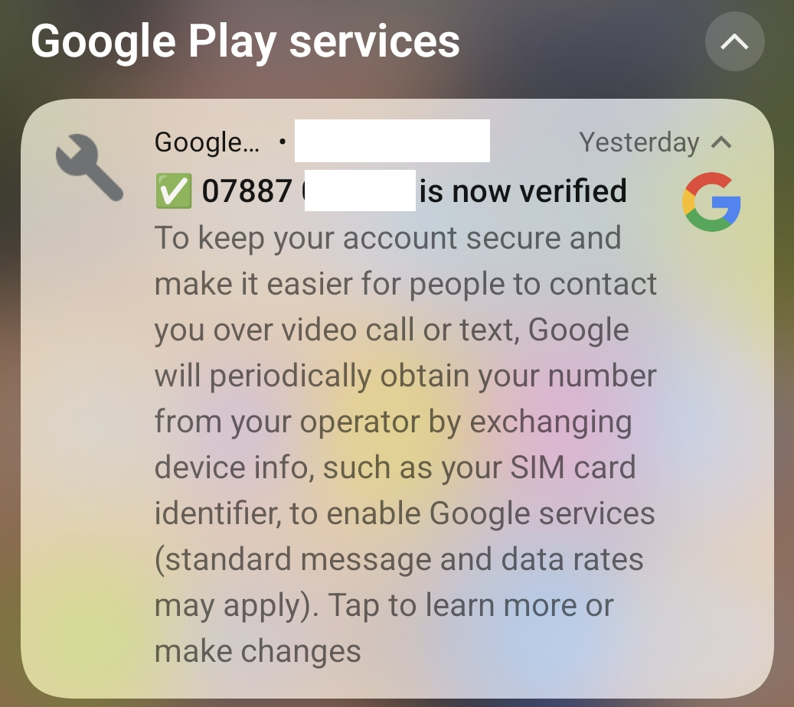
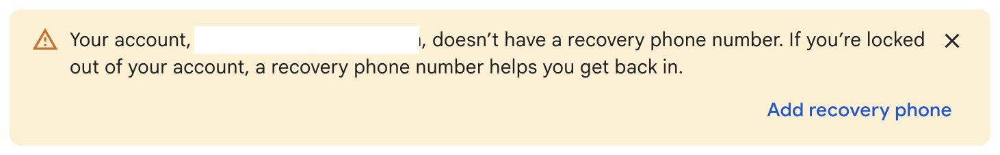

{:width="220px" style="float:left; margin-right: 10px;"}
This morning I woke to find a Google Play Services notification stating that my phone number was now verified. 

That's good news right? Well no, not so much really because the phone number in the notification was not one that I had ever provided to Google, so what was going on here? Is this a mistake? Had I been hacked?

Apparently not, this was Google making sure they could **enable Google Services** for me, presumably services like Gmail, Google Docs, Drive and Photos that I don't really use. 

Now I accept that a Google Account is part and parcel of having an Android phone, but what I don't accept is Google accessing my SIM cards, contacting my network providers and requesting the number. Not only that, but they have also applied this new number that they had no previous knowledge of to my Google Account.

You see, while I'm not being fitted for a tin-foil hat anytime soon, I am cautious about what information I share online and with the online services I sign up for.
<!--more-->

While I know that it is possible to use an Android phone without a Google Account it means finding an alternative to the Google Play Store to install the apps I need. While I know that alternatives exist they don't have the apps I absolutely need; my banking app for instance. 

So while I have a personal Google Account that is somewhat dormant, I decided to create a new one to use solely for my phone and when I signed up and reluctantly provided my personal phone number. 

This account was created a number of years ago, and I've never sent an email from it or backed up any data to it. Most of the Google apps and services have either been removed or disabled on my current phone, a OnePlus 12.

So what's the big deal? I 'willingly' created a Google Account and provided my phone number, why am I spitting my dummy out?

Well, the number on that notification is NOT the number I provided when I created my Google Account. No, that number was previously my work number when I was running my own business, nothing whatsoever to do with the Google Account. I kept the SIM because it's good to have an alternative data connection and incoming calls are now barred.

The business wasn't using Google for anything at all, so why is it OK for them to access information on my device, contact the network provider and then use my work number on what is essentially a personal Google Account?

Clicking the notification I was taken to a <a href='https://support.google.com/android/answer/7521240?hl=en' target='_blank'>Google Page explaining phone number verification</a> which provides numerous benefits and explains how the number was verified. Which is fine and I presumably have this by virtue of providing a valid phone number when I created the Google Account but this page says;

> To make sure the phone numbers are still yours, Google and your carrier will try to periodically reverify them. Carrier charges may apply. If you add new phone numbers to your device, those can be verified as well.

Now I have no real issue with Google verifying the phone number I used to create the Google Account. What I do have is a real issue with Google scanning my phone, finding an additional SIM card and then deciding to verify that with the network provider and apply the number to my Google Account. That's what I have a problem with!

The irony is that when I logged into my phones Google Account I saw this;

{:target='_blank'}

So despite now having two verified phone numbers, for my benefit apparently, Google has decided to not use either of them for account recovery. 

What's the point of going through the trouble of contacting my network provider and verifying the numbers if they aren't going to use them for the most basic of functions (which I thought I'd configured already anyway)?

## Final Thoughts (for now)
Now when it comes to smart phones I've always been an Android user rather than iPhone but this was mostly down to cost in the early days. But nowadays I can pick up a refurbished iPhone 15 or 16 for a few hundred quid, so it's perfectly viable for me to make the move to the Dark Side. But would I just be jumping out of one frying pan and into another (not into the fire necessarily)? Is Apple any better or just the lesser of two evils?

I could technically revert to a good old feature phone like the ones I had back in the day but while I can make it through an hour without checking social media, there are reasons I need to stick with a smart phone - primarily because my primary bank is online only and absolutely requires a smart phone.

I'm not going to make any rash decisions right now, but this could be another nudge towards a good old feature phone (and maybe get measured up for that tin foil hat)