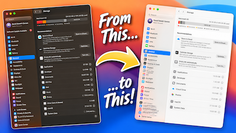
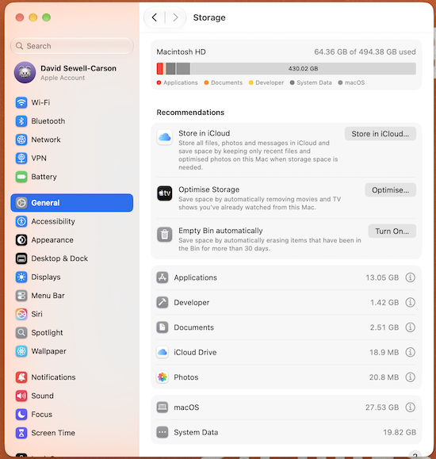

{:width="350px" style="float:left; margin-right: 10px;"}

There's something quite satisfying about starting with a clean slate, particularly when the alternative is spending hours trying to work out what's taking up all your disk space.

My MacBook Pro (affectionately known as Macbert) has been my primary development machine for some time now, and over the years I've installed and removed quite a collection of software. JetBrains Rider, .NET SDKs, Xcode, Android SDKs, Parallels, Docker and various other development tools have all had their moment.

The problem with development tooling is that uninstalling an application doesn't necessarily mean you've removed everything associated with it. SDKs, simulators, caches, build artefacts, virtual machines and assorted configuration files have a habit of hanging around long after you've moved on.

And it was beginning to show.

Disk space had gradually dwindled to the point where I had less than 100GB remaining. Now, that's not exactly a disaster on a machine with a reasonably large SSD, but it was getting a little ridiculous considering the software I was actually using.

I could have spent an evening hunting down unwanted files and reclaiming space, but that felt a little like treating the symptoms rather than the problem.

Perhaps it was time for a fresh start.

## Time for a reset

Rather than attempting to clean up the existing installation, I decided to bite the bullet and reset macOS completely.

Initially, I considered going down the traditional route of booting into Recovery, erasing the disk and reinstalling macOS. However, a little research pointed me towards Apple's **Erase All Content and Settings** option, available through System Settings on Apple Silicon Macs.

This is considerably simpler and achieves exactly what I wanted.

Before doing anything destructive, I made sure I had backups of my important files, development repositories and configuration. In particular, I wanted to retain my SSH keys, Git configuration and the various bits and pieces that make up my development environment.

I also made a point of checking that everything important was safely stored elsewhere. There's nothing quite like discovering you've deleted something you actually needed!

Once satisfied, I fired up Erase Assistant and let it do its thing.

The Mac restarted, presented me with the familiar Hello screen and, for all intents and purposes, I had a brand new MacBook Pro.

## Rebuilding the environment

This was where I needed a little discipline.

The temptation when setting up a new machine is to restore everything from a backup and get back to exactly where you were before. But that rather defeats the object of the exercise.

Instead, I signed back into my existing Apple Account, configured the Mac as a new device and deliberately avoided Migration Assistant and a wholesale Time Machine restore.

My files and personal data were restored selectively, and applications were installed as and when I needed them.

The development environment was rebuilt around what I'm actually doing today rather than what I might have needed a couple of years ago.

That meant getting the essentials back in place, including Rider, .NET, Git, Docker and Tailscale, without automatically reinstalling every SDK, workload and supporting tool that had accumulated over the years.

It was also a good opportunity to revisit my shell configuration and remove environment variables and tool initialisation that were no longer relevant.

## The results

So, was it worth the effort?

Well, let's just say the disk space figures speak for themselves.

When I started this exercise I had less than 100GB free. After the initial reset and installation of the essentials, that figure had climbed beyond 200GB.

Now, with the majority of my development environment restored and things pretty much back to where I need them, I'm sitting at around **430GB of free space**.

That's a rather satisfying improvement!

More importantly, I have a much better idea of what's installed, why it's there and what I actually need going forward.

{:target='_blank'}

## A fresh start

I'm not suggesting that reinstalling macOS should become an annual event, but there's something to be said for occasionally taking stock of the software and tooling you've accumulated.

Development environments are particularly prone to this sort of clutter. We're constantly installing new SDKs, trying out tools, switching frameworks and experimenting with technologies. Not everything gets removed when we move on.

For now, Macbert (now just 'Daves Macbook Pro') is looking considerably healthier, I've got plenty of breathing room and, hopefully, a slightly more disciplined approach to managing the development environment going forward.

Now, what was it I was supposed to be developing?